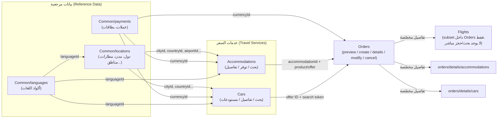

# Booking.com Demand API — دليل الموديولات والنقاط الكامل

> مصدر: `demand-api.json` (OpenAPI 3.1.0)

## نظرة عامة

| الخاصية | القيمة |
|---|---|
| **الاسم** | Booking.com Demand API |
| **الإصدار** | 3.2 |
| **البروتوكول** | REST عبر HTTPS، كل الطلبات **POST**، البيانات بصيغة JSON |
| **المصادقة** | `BearerAuth` (HTTP Bearer Token) + Header باسم Affiliate ID |
| **عدد الموديولات (Tags)** | 6 |
| **عدد النقاط (Endpoints)** | 32 |

### السيرفرات

| البيئة | الرابط | الاستخدام |
|---|---|---|
| Production | `https://demandapi.booking.com/3.2` | للتكاملات الفعلية (Live) |
| Sandbox | `https://demandapi-sandbox.booking.com/3.2` | للاختبار والتحقق قبل الإطلاق |

### تجميع الموديولات (x-tagGroups)

```
Travel services  → Accommodations, Cars
Common           → Common/locations, Common/payments, Common/languages
Orders           → Orders
```

---

## 1. موديول Accommodations (الإقامة)

خاص بالبحث عن أماكن الإقامة (فنادق، شقق، إلخ)، التحقق من التوفر والأسعار، وجلب بيانات مرجعية عنها (تقييمات، ثوابت، موردين).

### 1.1 `POST /accommodations/search` — Search
البحث عن أماكن إقامة مطابقة لمعايير محددة (موقع، تواريخ، عدد ضيوف...).
- افتراضيًا: يرجّع **أرخص منتج متاح** لكل مكان إقامة.
- عند تطبيق فلاتر موقع (دولة/منطقة)، تُرتَّب النتائج حسب شعبية Booking.com (Top picks) وليس بالسعر.

### 1.2 `POST /accommodations/availability` — Availability
فحص التوفر الفعلي (Real-time) والأسعار والرسوم لعدد يصل حتى **50 accommodation ID**.
- افتراضيًا يرجّع فقط توفر المنتج وسعره.
- باستخدام `extras`/`filters` يمكن جلب تفاصيل إضافية (رسوم إضافية، معلومات دفع).
- **حقول إلزامية**: `accommodations`, `booker`, `checkin`, `checkout`, `guests`.

### 1.3 `POST /accommodations/chains` — Chains
جلب قائمة **سلاسل الفنادق (Chains)** والعلامات التجارية (Brands) التابعة لها.
- مثال: "Radisson Hotel Group" تضم "Radisson Blu"، "Park Inn by Radisson".
- الـ `id` المُرجَعة تُستخدم كمُعرِّف موحّد للفلترة في endpoints أخرى.
- جسم طلب فارغ = القائمة الكاملة.

### 1.4 `POST /accommodations/constants` — Constants
جلب أكواد وأسماء موحّدة (Canonical) لعناصر مرتبطة بالإقامة: المرافق (facilities)، أنواع الغرف، أنواع الأسرّة، الثيمات، الرسوم الإضافية.
- تدعم تعدد اللغات عبر أكواد IETF.
- جسم فارغ = كل الثوابت. أو حدد قسمًا معينًا عبر مصفوفة `constants` (مثل `accommodation_facilities`, `bed_types`).

### 1.5 `POST /accommodations/details` — Details
جلب معلومات تفصيلية (ثابتة/وصفية) عن أماكن الإقامة.
- يجب توفير واحد على الأقل من: `accommodations`, `airport`, `city`, `country`, `region`.
- استخدم `extras` لجلب `facilities`, `photos`, `policies`, `rooms`, `bundles`.
- هذه بيانات **وصفية ثابتة فقط** — التوفر والسعر يُجلبان من endpoint منفصل (`/availability`).
- حد أقصى 100 ID في الطلب الواحد.

### 1.6 `POST /accommodations/details/changes` — Updates
تتبّع أماكن الإقامة التي تم فتحها/إغلاقها أو تحديث محتواها منذ توقيت (timestamp) محدد.
- يشمل تحديثات: معلومات عامة، مرافق، غرف، صور، دفعات، إلخ.
- يمكن الفلترة حسب `country` أو `city`.
- استخدم قيمة `next` من الاستجابة لجلب الدفعة التالية من التحديثات (Pagination زمني).
- يُستخدم بالتزامن مع `/accommodations/details` لتحديث الكاش المحلي.
- حتى ~5000 ID لكل طلب.

### 1.7 `POST /accommodations/reviews` — Reviews
جلب تقييمات المسافرين لأماكن إقامة محددة، مع دعم الفرز والفلترة وتحديد عدد التقييمات (`rows`).
- ⚠️ التقييمات تعكس **كل** حركة المرور على Booking.com، وليس عملاءك فقط.

### 1.8 `POST /accommodations/reviews/scores` — Review and scores
جلب توزيع الدرجات (Score distribution) وتفصيل الدرجات لأماكن إقامة محددة، قابلة للفلترة حسب المراجع واللغة.

### 1.9 `POST /accommodations/third-party-suppliers` — Third-party suppliers
جلب قائمة الموردين الخارجيين (Third-party suppliers) الذين يوفرون مخزون إقامة عبر Booking.com.
- عندما يكون المنتج مقدَّمًا من مورد خارجي: `inventory.third_party = true` و `inventory.third_party_supplier_id` يحمل معرّف المورد.
- استخدم `id` المُرجَعة لمطابقة `inventory.third_party_supplier_id` القادم من `/accommodations/availability`.
- جسم فارغ = القائمة الكاملة.

---

## 2. موديول Cars (تأجير السيارات)

خاص بالبحث عن سيارات للإيجار، تفاصيلها، مستودعات الاستلام/التسليم (Depots)، والموردين.

### 2.1 `POST /cars/search` — Search car rentals
جلب السيارات المتاحة للإيجار المطابقة لمعايير البحث.

### 2.2 `POST /cars/constants` — Car constants
جلب ثوابت مُوطَّنة (Localised) تُستخدم عبر مجموعة Cars API: الإضافات (extras)، سياسات الوقود، توقيت الدفع، أنواع ناقل الحركة.
- تُرجع أيضًا إيميلات خدمة العملاء لكل لغة (لحالات يتولى فيها Booking.com التواصل مع المسافر مباشرة).
- جسم فارغ = كل الثوابت.

### 2.3 `POST /cars/depots` — Depots
جلب قائمة مُقسَّمة إلى صفحات (Paginated) لمستودعات (نقاط استلام/تسليم) تأجير السيارات.
- تدعم تحديثات تدريجية عبر فلتر `last_modified`.

### 2.4 `POST /cars/depots/reviews/scores` — Depot scores
جلب درجات التقييم وتفصيلها للمستودعات، شاملاً الدرجة الإجمالية وعدد التقييمات.

### 2.5 `POST /cars/details` — Car details
جلب تفاصيل السيارة نفسها: سعة الحقائب، عدد الأبواب، الماركة والموديل، إلخ.

### 2.6 `POST /cars/suppliers` — Suppliers
جلب قائمة موردي تأجير السيارات.
- يمكن تمرير Supplier ID واحد أو مصفوفة منها لجلب تفاصيل محددة.
- بدون ID = كل الموردين.

---

## 3. موديول Common/locations (المواقع الجغرافية المرجعية)

بيانات مرجعية (Reference data) للمواقع الجغرافية، تُستخدم كمدخلات/مخرجات موحّدة عبر بقية الـ API (بحث، فلترة، إلخ).

### 3.1 `POST /common/locations/airports` — Airports
قائمة أكواد المطارات (IATA) وأسمائها باللغات المطلوبة.
- قابلة للفلترة حسب معرّف موقع، مثل `{"country":"nl"}`.
- جسم فارغ = القائمة الكاملة. تدعم Pagination.

### 3.2 `POST /common/locations/cities` — Cities
قائمة معرّفات المدن (City IDs) وأسمائها.
- فلترة حسب موقع، مثل `{"country":"nl"}`.
- إذا كان City ID غير موجود في القائمة الكاملة (bulk)، يمكن جلبه مباشرة عبر `{"city": <id>}`.

### 3.3 `POST /common/locations/countries` — Countries
قائمة أكواد الدول وأسمائها.
- فلترة حسب موقع (مثل منطقة جغرافية: `{"region":1199}`).
- تدعم Pagination.

### 3.4 `POST /common/locations/districts` — Districts
قائمة الأحياء (Districts) مع ترجماتها.
- فلترة حسب موقع (مثال: أحياء أمستردام عبر `{"city":-2140479}`).
- تدعم Pagination.

### 3.5 `POST /common/locations/landmarks` — Landmarks
قائمة المعالم الجغرافية (Landmarks) البارزة وأسمائها.
- فلترة حسب موقع (مثال: معالم باريس عبر `{"city":-1456928}`).
- تدعم Pagination.

### 3.6 `POST /common/locations/regions` — Regions
قائمة المناطق (Regions) مع ترجماتها.
- فلترة حسب موقع (مثال: مناطق هولندا عبر `{"country":"nl"}`).
- تدعم Pagination.

---

## 4. موديول Common/payments (بيانات الدفع المرجعية)

### 4.1 `POST /common/payments/cards` — Retrieve payment cards
قائمة بطاقات الدفع المدعومة (Credit/Debit) وأسمائها بالإنجليزية.
- جسم فارغ = القائمة الكاملة.

### 4.2 `POST /common/payments/currencies` — Retrieve currency codes
قائمة أكواد العملات (ISO 4217) وأسمائها باللغات المطلوبة.
- الأكواد المُرجَعة تُستخدم كمدخلات/مخرجات موحّدة في بقية الـ API (مثل حقل `currency`).

---

## 5. موديول Common/languages (اللغات)

### 5.1 `POST /common/languages` — Retrieve language codes
قائمة أكواد اللغات البشرية وأسمائها باللغة المقابلة نفسها.
- جسم فارغ = القائمة الكاملة.
- هذه الأكواد هي ما يُستخدم في باقي الـ API لطلب محتوى بلغة معينة (IETF language tags).

---

## 6. موديول Orders (الطلبات وإدارة الحجوزات)

الموديول المحوري الذي يدير **دورة حياة الحجز الكاملة**: من المعاينة (Preview)، إلى الإنشاء (Create)، فالاستعلام عن التفاصيل، ثم التعديل أو الإلغاء. يغطي كل خدمات السفر (إقامة، سيارات، رحلات، ويشمل أيضًا Attractions وTaxis في التقارير اللاحقة للحجز).

### 6.1 `POST /orders/preview` — Preview an order
التحقق من صلاحية الطلب **قبل** إتمام الدفع، وحساب السعر النهائي (تفصيل السعر، جدول الدفعات، سياسات الإلغاء).
- **للإقامة**: تواريخ الوصول/المغادرة، توزيع الغرف، المنتجات المختارة.
- **للسيارات**: Offer ID و Search token، مع إمكانية إضافة إضافات اختيارية (GPS، مقعد طفل) أو تأمين طرف ثالث (`insurance.quote_reference`) من `/cars/availability`.
- يتطلب بيانات الحاجز (booker) والعملة المفضّلة لعرض سعر مخصّص.

### 6.2 `POST /orders/create` — Create an order
إنشاء وتأكيد طلب حجيز فعلي باستخدام **order token** صالح (غالبًا من `/orders/preview`) ومعلومات الدفع المطلوبة.

### 6.3 `POST /orders/details` — Orders details (العام لكل الخدمات)
استرجاع تفاصيل الطلبات الحالية عبر **كل خدمات السفر المدعومة** دفعة واحدة — لمزامنة الأنظمة الداخلية، متابعة تحديثات الحجز، وإعداد تقارير/تحليلات شاملة.
- طرق الفلترة (اختر واحدة):
  - **تاريخ الإنشاء/التحديث** (نطاق 7 أيام).
  - **تواريخ السفر** (بداية/نهاية الخدمة، حتى 7 أيام).
  - **Order ID** أو **Reservation ID** محدد.
- `currency` حقل إلزامي (كود ISO 4217 من 3 أحرف).
- `services` يحصر النتائج بخدمة أو أكثر: `accommodations`, `cars`, `flights`, `attractions`, `taxis`.
- الاستخدامات: لوحات تحكم الشركاء، صفحات تأكيد المسافر، الفوترة والتسوية، التقارير.

### 6.4 `POST /orders/details/accommodations` — Orders with accommodation details
تفاصيل مخصّصة لطلب/طلبات **إقامة** واحدة أو أكثر.
- بحث عبر `reservation` أو `order` ID.
- يشمل: حالة الحجز، السعر، العمولة، تفاصيل الإلغاء، الإضافات الاختيارية.
- النتائج مرتبة تنازليًا حسب تاريخ الإنشاء (الأحدث أولًا).

### 6.5 `POST /orders/details/cars` — Orders with car details
تفاصيل مخصّصة لطلب/طلبات **تأجير سيارات**.
- بحث عبر `reservation` ID.
- يشمل: تفاصيل الحجز والإلغاء، العمولة، السعر، إضافات اختيارية (مثل السياسات).
- النتائج مرتبة تنازليًا حسب تاريخ الإنشاء.

### 6.6 `POST /orders/details/flights` — Orders with flight details
تفاصيل مخصّصة لطلب/طلبات **رحلات جوية**.
- بحث عبر `order ID` أو `reservation ID`.
- يشمل: بيانات منظمة عن السعر، مسار الرحلة (itinerary segments) بأكواد مطارات IATA.
- الاستخدامات: لوحات تحكم المسافر، صفحات تأكيد، الفواتير، التقارير والتسوية.
- ⚠️ لا يوجد endpoint للبحث/الحجز المباشر للرحلات — فقط استرجاع تفاصيل ما تم حجزه.

### 6.7 `POST /orders/modify` — Modify an order
تعديل جوانب معينة من طلب **إقامة**: بيانات بطاقة الائتمان، تواريخ الوصول/المغادرة، إعدادات الغرفة (توزيع الضيوف، الأسماء، تفضيل التدخين).

### 6.8 `POST /orders/cancel` — Cancel a travel service
إلغاء خدمة سفر واحدة ضمن طلب قائم (حجز أو بوليصة تأمين).
- ⚠️ يمكن إلغاء **خدمة واحدة فقط** لكل طلب إلغاء (لا يمكن إلغاء أكثر من خدمة في نفس النداء).

---

## 7. الـ Schemas المشتركة (العقد المحورية / "God Nodes")

هذه ليست موديولات منفصلة، بل **بيانات/أنواع مشتركة (Shared types)** يُعاد استخدامها عبر عشرات النقاط. فهمها هو مفتاح فهم "الترابط الحقيقي" بين الموديولات، لأنها الخيوط التي تربطهم ببعض. الترتيب أدناه حسب **عدد مرات الاستخدام الفعلي** داخل الملف (كلما زاد الرقم، زادت مركزية الـ schema):

| Schema / Parameter | عدد مرات الاستخدام | ماذا يعني |
|---|---|---|
| `currencyId` | 40 | كود عملة (3 أحرف، ISO 4217) — العمود الفقري لأي سعر في الـ API بالكامل |
| `requestId` | 33 | معرّف فريد لكل طلب (Request)، يُرجَع في كل استجابة تقريبًا — يُستخدم عند التواصل مع الدعم الفني |
| `AffiliateIdHeader` (Header: `X-Affiliate-Id`) | 32 | **إلزامي في كل استدعاء تقريبًا** — رقم هوية الشريك (Affiliate) نفسه |
| `monetaryAmount` | 30 | رقم عشري موجب يمثّل قيمة مالية خام (بدون عملة مرفقة) |
| `translatedString` | 28 | نص مترجم بعدة لغات، مثل `{"en-us":"...", "ar":"..."}` |
| `countryId` | 26 | كود دولة (حرفان، ISO 3166-1 alpha-2)، مصدره `/common/locations/countries` |
| `error_response` | 26 | الشكل الموحّد لأي خطأ يرجعه أي endpoint |
| `languageId` | 22 | كود لغة (IETF tag)، مصدره `/common/languages` |
| `maximumResults` / `page` | 17 / 15 | أدوات الـ Pagination الموحّدة عبر أغلب نقاط البحث/القوائم |
| `priceCurrencyOutput` | 13 | تركيبة سعر بعملتين (عملة المنتج + عملة الحاجز) |
| `accommodationId` / `cityId` / `regionId` / `airportId` / `districtId` / `landmarkId` | 8-12 لكل منها | معرّفات الموقع الجغرافي، مصدرها موديول **Common/locations** |
| `services` | 6 | مصفوفة تحدد أي خدمة سفر (`accommodations, cars, flights, attractions, taxis`) — تظهر في `/orders/details` |
| `status` | 5 | حالة الطلب (تختلف قيمها حسب نوع الخدمة كما شرحنا سابقًا) |

### 7.1 شرح أهم الـ Schemas بالتفصيل (بالعربي)

- **`currencyId`**: نص من 3 أحرف كبيرة مثل `"EUR"`. القائمة الكاملة المعتمدة تأتي حصريًا من `/common/payments/currencies` — **لازم تجيبها أول مرة وتخزّنها محليًا**، لأن أي endpoint يطلب عملة يتوقع كود من هذه القائمة بالضبط.
- **`monetaryAmount`**: مجرد رقم (مثل `212.86`) — لا يحمل عملة بنفسه، ولذلك يظهر دائمًا **داخل** كائن أكبر مثل `priceCurrencyOutput` أو `priceOutput` اللي يوضّح العملة المرتبطة به.
- **`priceOutput`** (`{booker_currency, order_currency}`) و **`currencyOutput`** (`{booker_currency, order_currency}`): هذا النمط (زوج قيمتين: بعملة الحاجز وبعملة الطلب) يتكرر في كل مكان مرتبط بالطلبات (Orders) — لأن الحاجز ممكن يدفع بعملة مختلفة عن عملة إنشاء الطلب نفسه.
- **`translatedString`**: تصميم موحّد لأي نص متعدد اللغات، تلاقيه في أسماء الدول/المدن/المرافق... إلخ. المفتاح هو كود اللغة (`en-us`, `ar`, `nl`...) والقيمة هي الترجمة.
- **`error_response`**: كل الأخطاء في الـ API (بغض النظر عن الموديول) تُرجَع بنفس الشكل: `request_id` + مصفوفة `errors[]` كل عنصر فيها `id` و`message`. هذا معناه إنك تقدر تكتب **معالج أخطاء واحد (Error Handler)** يشتغل على كل نقاط الـ API بدون استثناء.
- **`AffiliateIdHeader`**: مو schema بيانات عادي، لكنه **Header إلزامي** (`X-Affiliate-Id`) يظهر في 32 من أصل 32 نقطة تقريبًا. بمعنى: مفيش استدعاء واحد للـ API من غير ما ترسل هوية الشريك في الهيدر + التوكن (`BearerAuth`) في نفس الوقت.
- **معرّفات المواقع** (`cityId`, `countryId`, `regionId`, `airportId`, `districtId`, `landmarkId`): كلها أرقام أو أكواد **مصدرها الوحيد** موديول Common/locations. أي endpoint بحث (Accommodations, Cars, Orders) يقبل هذه المعرّفات كمدخل فلترة.

### 7.2 خريطة الترابط بين الموديولات (Mermaid)

هذا الرسم يوضّح "من يعتمد على من" فعليًا — أي موديول هو **مصدر بيانات مرجعية** يُستهلَك من موديولات أخرى، وأيهم "يجمع" كل شيء في النهاية:



**قراءة الرسم بالعربي:**
- **Common/*** هي القاعدة (Foundation) — كل شيء آخر يستهلك منها (IDs جغرافية، عملات، لغات) ولا يعتمد هو نفسه على أي موديول آخر. لازم تُستدعى أولًا في أي تكامل جديد.
- **Accommodations** و **Cars** هما "خدمات بحث واختيار" (Search & Select) — تستهلكان بيانات Common، وتنتجان مُعرِّفات منتج (Product ID / Offer ID) تُستخدم لاحقًا في Orders.
- **Orders** هو "المحور" (Hub) — لا يوجد بحث للرحلات، بل الرحلات تظهر فقط كنتيجة داخل Orders (لأن حجزها يتم من مصدر خارج هذا الـ API، وهذا الـ API فقط يديرها بعد الحجز).
- كل الأسهم التي تحمل `currencyId` أو `languageId` تعني: **نفس الكود بالحرف** يُستخدم في كل الاتجاهات — لو غيّرت مصدر العملة أو اللغة، يجب أن يتوافق عبر كل الموديولات.

### 7.3 تدفّق تكامل واقعي (Realistic Integration Flow)

هذا هو الترتيب المنطقي الذي يتّبعه أي تكامل حقيقي مع هذا الـ API، وكل خطوة تبني على السابقة:

1. **تجهيز البيانات المرجعية (مرة واحدة، وتُحدَّث دوريًا):**
   `/common/languages` → `/common/payments/currencies` → `/common/locations/*` → `/accommodations/constants` → `/cars/constants`
   *(لماذا؟ لأن باقي الـ API يتوقع منك إرسال أكواد بالضبط كما عرّفتها هذه النقاط.)*

2. **البحث والاختيار (Search & Select):**
   `/accommodations/search` أو `/cars/search` → (اختياري) `/accommodations/availability` لتفاصيل توفر أدق.

3. **المعاينة (Preview):**
   `/orders/preview` — يأخذ نتيجة الخطوة 2 (Offer/Product ID) + بيانات الحاجز، ويرجّع السعر النهائي والـ order token.

4. **الحجز (Create):**
   `/orders/create` — يستخدم الـ token من الخطوة 3 + معلومات الدفع لتأكيد الحجز فعليًا.

5. **ما بعد الحجز (Post-booking):**
   - استعلام: `/orders/details` (عام) أو `/orders/details/accommodations` \| `/cars` \| `/flights` (مخصّص).
   - تعديل: `/orders/modify` (إقامة فقط).
   - إلغاء: `/orders/cancel` (خدمة واحدة في كل مرة).

> ⚠️ **ملاحظة مهمة**: الرحلات الجوية (Flights) تدخل التدفق **فقط من الخطوة 5** — لا يوجد لها خطوة 1-4 داخل هذا الـ API، لأنها كما وضّحنا تُحجز من مصدر آخر، وهذا الـ API يقتصر دوره على القراءة والإدارة بعد الحجز.

---

## ملخص سريع — جدول كل النقاط

| # | الموديول | Endpoint | الوظيفة بإيجاز |
|---|---|---|---|
| 1 | Accommodations | `/accommodations/search` | بحث عن أماكن إقامة |
| 2 | Accommodations | `/accommodations/availability` | توفر وأسعار فعلية |
| 3 | Accommodations | `/accommodations/chains` | سلاسل الفنادق والعلامات |
| 4 | Accommodations | `/accommodations/constants` | ثوابت مرجعية (مرافق، غرف...) |
| 5 | Accommodations | `/accommodations/details` | بيانات وصفية تفصيلية |
| 6 | Accommodations | `/accommodations/details/changes` | تتبّع التحديثات |
| 7 | Accommodations | `/accommodations/reviews` | تقييمات المسافرين |
| 8 | Accommodations | `/accommodations/reviews/scores` | توزيع الدرجات |
| 9 | Accommodations | `/accommodations/third-party-suppliers` | موردو المخزون الخارجي |
| 10 | Cars | `/cars/search` | بحث عن سيارات إيجار |
| 11 | Cars | `/cars/constants` | ثوابت مرجعية للسيارات |
| 12 | Cars | `/cars/depots` | مستودعات الاستلام/التسليم |
| 13 | Cars | `/cars/depots/reviews/scores` | تقييمات المستودعات |
| 14 | Cars | `/cars/details` | تفاصيل السيارة |
| 15 | Cars | `/cars/suppliers` | موردو تأجير السيارات |
| 16 | Common/languages | `/common/languages` | أكواد اللغات |
| 17 | Common/locations | `/common/locations/airports` | أكواد المطارات |
| 18 | Common/locations | `/common/locations/cities` | معرّفات المدن |
| 19 | Common/locations | `/common/locations/countries` | أكواد الدول |
| 20 | Common/locations | `/common/locations/districts` | الأحياء |
| 21 | Common/locations | `/common/locations/landmarks` | المعالم الجغرافية |
| 22 | Common/locations | `/common/locations/regions` | المناطق |
| 23 | Common/payments | `/common/payments/cards` | بطاقات الدفع المدعومة |
| 24 | Common/payments | `/common/payments/currencies` | أكواد العملات |
| 25 | Orders | `/orders/preview` | معاينة طلب قبل الدفع |
| 26 | Orders | `/orders/create` | إنشاء وتأكيد طلب |
| 27 | Orders | `/orders/details` | تفاصيل طلبات (كل الخدمات) |
| 28 | Orders | `/orders/details/accommodations` | تفاصيل طلبات إقامة |
| 29 | Orders | `/orders/details/cars` | تفاصيل طلبات سيارات |
| 30 | Orders | `/orders/details/flights` | تفاصيل طلبات رحلات |
| 31 | Orders | `/orders/modify` | تعديل طلب إقامة |
| 32 | Orders | `/orders/cancel` | إلغاء خدمة ضمن طلب |
